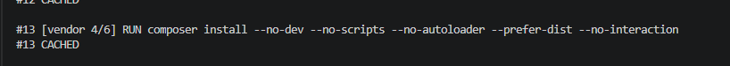

# Kodigo Shop · Ecosistema dockerizado

Práctica de Docker: **builds multi-stage y optimización de capas** para un e-commerce desarrollado en el bootcamp.

| Servicio | Tecnología | Puerto en el host |
|---|---|---|
| `frontend` | Next.js 16 (App Router) | `3000` |
| `nginx` | Nginx (proxy inverso) | `8000` |
| `backend` | Laravel 13 + PHP 8.4 (PHP-FPM) | — (interno) |
| `db` | MySQL 8.0 | — (interno) |

## 🏗 Arquitectura

```
Navegador ──:3000──▶ frontend ──http://nginx/api──▶ nginx ──FastCGI:9000──▶ backend ──:3306──▶ db
                                                      ▲                                         │
Navegador ──:8000─────────────────────────────────────┘                             volumen db_data
```

- Los servicios se comunican por **nombre de servicio** en la red interna de Compose (`DB_HOST=db`, `fastcgi_pass backend:9000`).
- **MySQL y PHP-FPM no se exponen al host**: solo los alcanzan los servicios que los necesitan.
- **Orden de arranque:** `db` (healthcheck OK) → `backend` → `nginx` → `frontend`.

## 🚀 Cómo ejecutarlo

Requisitos: Docker Desktop y claves de Stripe en modo prueba.

```bash
# 1. Clonar el repositorio
git clone https://github.com/Kodigo-Hub-FSJ36/actividad-docker-multistage.git
cd actividad-docker-multistage

# 2. Crear el .env y rellenar los valores (ver comentarios en el archivo)
cp .env.example .env

# 3. Levantar todo el ecosistema
docker compose up -d --build

# 4. Crear tablas y datos de ejemplo (solo la primera vez)
docker compose exec backend php artisan migrate --seed --force
```

Después abre **http://localhost:3000** para la tienda y **http://localhost:8000/api/products** para la API.

Para detenerlo, usa `docker compose down`, que conserva los datos. Con `docker compose down -v` se borra también la base de datos.

## 🧠 Decisiones técnicas

### Backend (`backend/Dockerfile`)

Tiene dos etapas: **`composer:2`** instala las dependencias y **`php:8.4-fpm-alpine`** las ejecuta.

- **Solo `vendor/` llega a la imagen final.** Composer y las herramientas de build se quedan en la primera etapa.
- **PHP 8.4 en lugar de 8.2.** El `composer.lock` incluye Symfony 8, que exige PHP ≥ 8.4.1. La versión de la imagen debe coincidir con la que generó el lock.
- **Extensiones.** La imagen base ya trae `mbstring`, `openssl`, `tokenizer`, `xml`, `ctype` y `json`. Solo se instalan `pdo_mysql` (conexión a MySQL) y `opcache` (rendimiento).
- **`--no-dev`.** Sin PHPUnit, Pail ni otras dependencias de desarrollo.
- **Caché de capas.** Se copian `composer.json` y `composer.lock` antes que el código. Si solo cambia el código, `composer install` sale de caché.
- **`.dockerignore`.** Excluye `.env`, `vendor/`, `tests/` y `bootstrap/cache/*.php`. Esta última es una caché local que hacía fallar la imagen al registrar paquetes de desarrollo.

### Nginx (`nginx/default.conf`)

PHP-FPM no entiende HTTP, solo FastCGI. Nginx recibe las peticiones en el puerto 80 y las reenvía a `backend:9000`. Usa la imagen oficial `nginx:alpine` con la configuración montada en solo lectura.

### Frontend (`frontend/Dockerfile`)

Tiene cuatro etapas sobre `node:20-alpine`: `deps` → `builder` (`next build`) → `prod-deps` → `runner`.

- **La imagen final solo tiene lo necesario para `next start`**: `.next/`, `public/` y `node_modules` de producción. No lleva el código fuente, ni pnpm, ni TypeScript o ESLint.
- **pnpm con `--frozen-lockfile`.** Garantiza las mismas versiones en todos los entornos.
- **`NEXT_PUBLIC_STRIPE_PUBLISHABLE_KEY` como `ARG`.** Next la incrusta en el JavaScript durante el build. Los secretos nunca se pasan por `ARG`, porque quedan visibles en `docker history`.
- **`API_BASE_URL=http://nginx/api` en ejecución.** Next llama a la API desde el servidor, dentro de la red interna.
- **`rm -rf .next/cache`** tras el build: la imagen pesa 80 MB menos.
- **`USER node`.** El proceso no corre como root.

### Base de datos (servicio `db`)

- Imagen oficial `mysql:8.0`, configurada con variables de entorno.
- **Volumen `db_data`** en `/var/lib/mysql`, para que los datos persistan entre reinicios.
- **Mínimo privilegio.** Laravel usa `MYSQL_USER`, que solo tiene permisos sobre su base. Root queda para administración.
- **Healthcheck + `depends_on: service_healthy`.** El backend espera a que MySQL esté listo.
- **Sin script SQL inicial.** El esquema lo crean las migraciones y seeders de Laravel.

### Secretos

Todos viven en un único `.env` en la raíz, que no se sube al repositorio. `.env.example` los documenta. Cada servicio recibe solo las variables que necesita, y ninguna imagen contiene archivos `.env`.

## 📊 Resultados

| Imagen | Tamaño en disco | Comprimido |
|---|---|---|
| `actividad-docker-multistage-backend` | 207 MB | 45 MB |
| `actividad-docker-multistage-frontend` (antes de optimizar) | 757 MB | 182 MB |
| `actividad-docker-multistage-frontend` (final) | **677 MB** | **144 MB** |

### Caché de capas

Después de modificar solo un controlador, se reconstruyó el backend con `docker compose build backend`. El paso `composer install` aparece como **`CACHED`**: Docker reutilizó la capa de dependencias porque `composer.json` y `composer.lock` no cambiaron, y solo se rehicieron las capas posteriores al `COPY . .`. Así el build no vuelve a descargar las dependencias y termina mucho más rápido. Las dependencias solo se reinstalan cuando cambia alguno de esos dos archivos.


