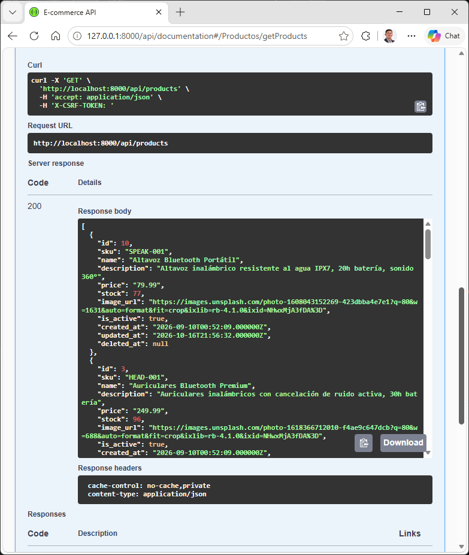
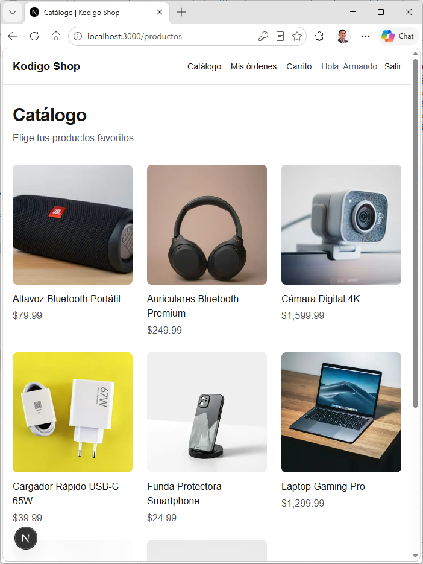
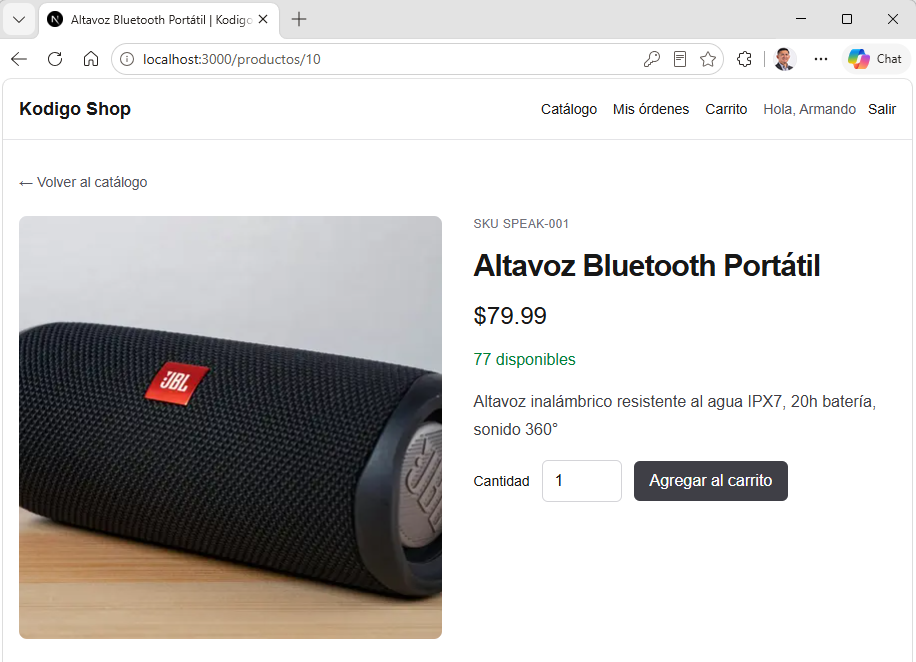
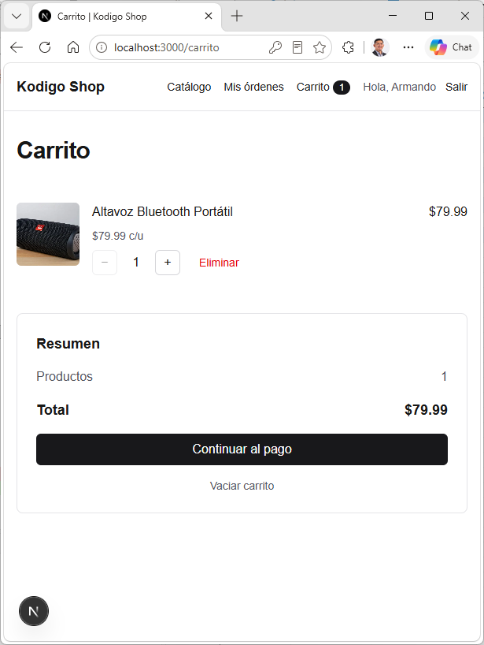
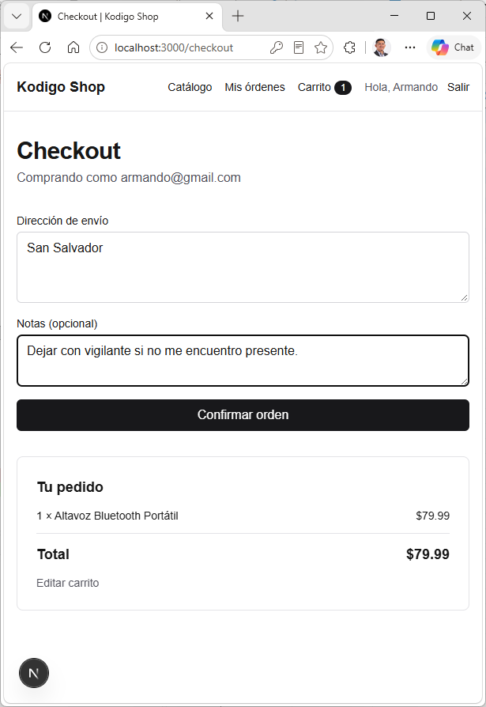
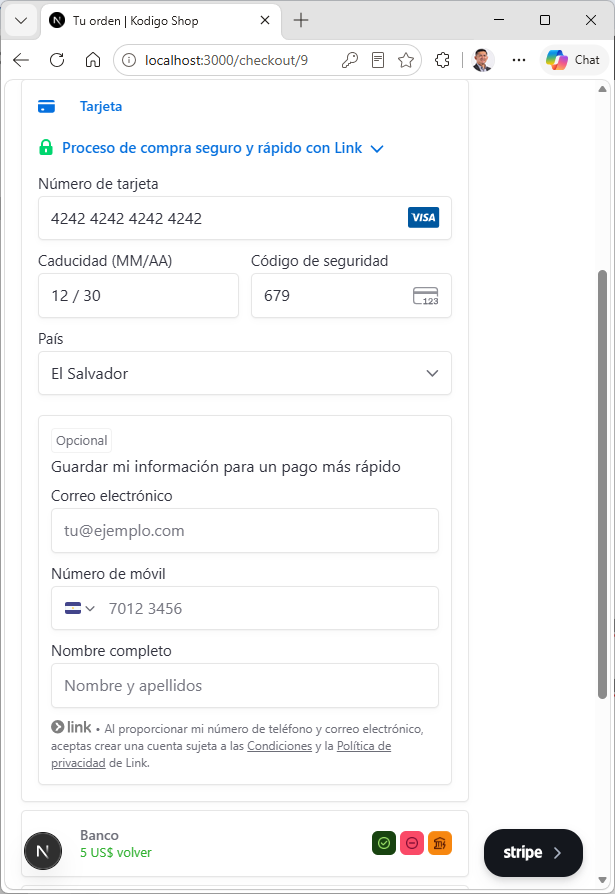
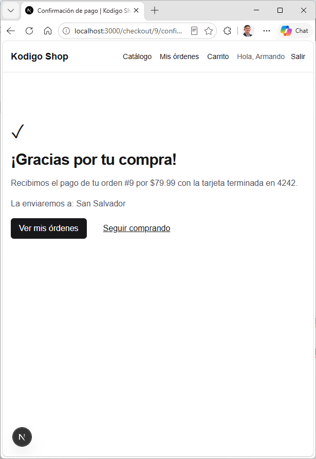
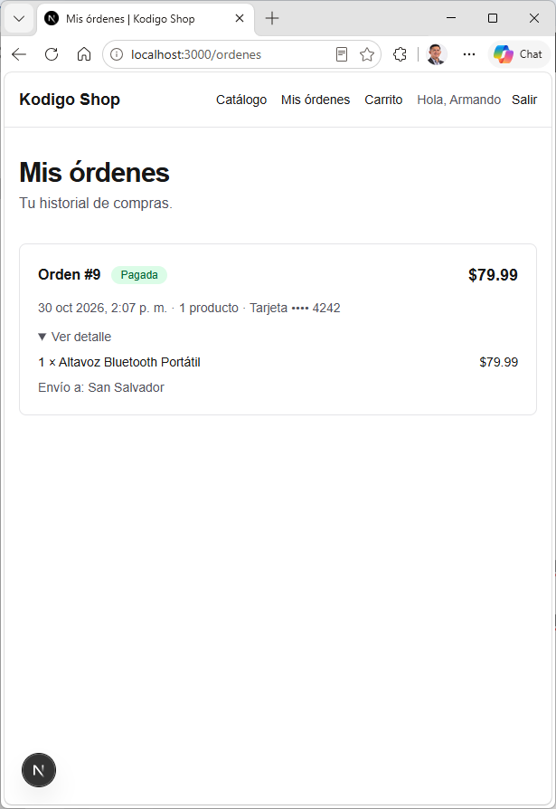
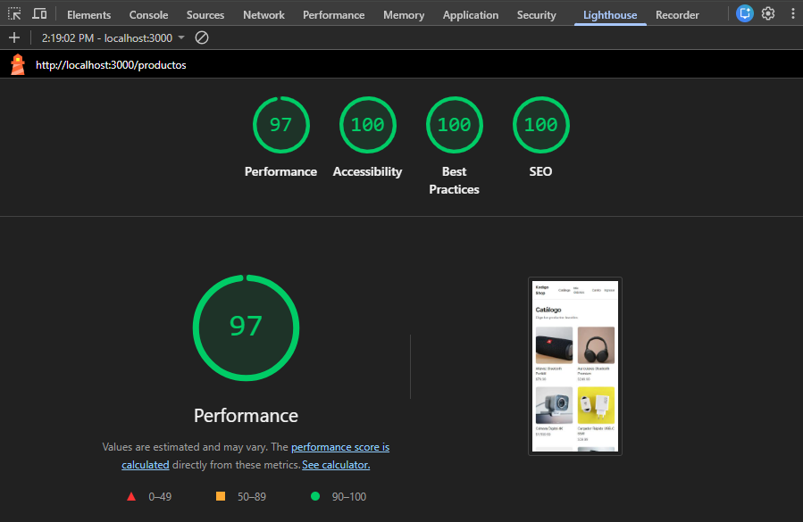
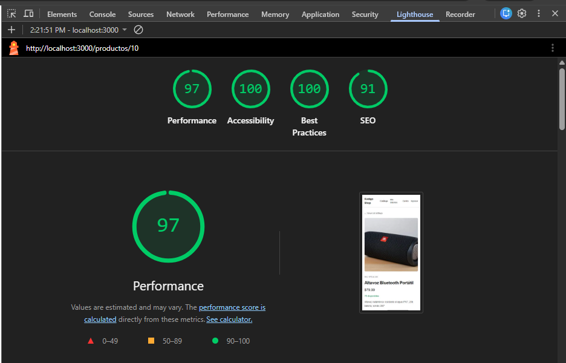

# Kodigo Shop · Frontend en Next.js

Frontend de e-commerce construido con **Next.js 16 (App Router) + TypeScript** que consume la API REST de e-commerce (Laravel + Swagger + Stripe). Cubre el flujo completo de compra: catálogo, autenticación, carrito, orden, pago con Stripe e historial de compras.

- **Lecturas** con Server Components (`fetch` en el servidor).
- **Mutaciones** con Server Actions (login, registro, logout, crear orden, pago).
- **Estilos** con Tailwind CSS 4.

## Requisitos

- Node.js 20.9 o superior y [pnpm](https://pnpm.io/).
- La API de e-commerce corriendo (por defecto en `http://localhost:8000`).
- Una cuenta de Stripe en **modo prueba** (la clave secreta `sk_test_...` vive solo en la API; aquí solo va la publicable).

## Variables de entorno

Copia `.env.example` a `.env.local` y completa los valores:

```bash
cp .env.example .env.local
```

```env
# URL base de la API de Laravel (incluye el prefijo /api)
API_BASE_URL=http://localhost:8000/api

# Clave publicable de Stripe en modo prueba (pk_test_...). Es pública: la usa el navegador.
NEXT_PUBLIC_STRIPE_PUBLISHABLE_KEY=
```

| Variable | Dónde se usa | Descripción |
| --- | --- | --- |
| `API_BASE_URL` | Solo servidor | URL base de la API, con el prefijo `/api`. El navegador nunca habla directo con la API. |
| `NEXT_PUBLIC_STRIPE_PUBLISHABLE_KEY` | Navegador | Clave `pk_test_...` para montar el Payment Element de Stripe. |

`.env.local` está en `.gitignore`: nunca se sube al repositorio.

## Cómo ejecutar

```bash
# 1. Instalar dependencias
pnpm install

# 2. Levantar la API (en su propio proyecto)
php artisan serve        # queda en http://localhost:8000

# 3a. Modo desarrollo
pnpm dev                 # http://localhost:3000

# 3b. Modo producción (el que se usa para medir Lighthouse)
pnpm build
pnpm start
```

Otros comandos: `pnpm lint` (ESLint) y `pnpm exec tsc --noEmit` (chequeo de tipos).

**Tarjeta de prueba de Stripe:** `4242 4242 4242 4242`, cualquier fecha futura y cualquier CVC. Para probar un rechazo: `4000 0000 0000 0002`.

## Rutas implementadas

| Ruta | Acceso | Qué hace |
| --- | --- | --- |
| `/` | Pública | Inicio con acceso al catálogo. |
| `/productos` | Pública | Catálogo paginado (`?page=N`) con `loading.tsx`, `error.tsx` y la grilla dentro de `<Suspense>`. |
| `/productos/[id]` | Pública | Detalle del producto con metadata SEO propia (`generateMetadata`: título, descripción y Open Graph) y botón para agregar al carrito. |
| `/login` | Pública | Inicio de sesión con Server Action. Respeta `?next=` para volver a la página protegida que pidió el usuario. |
| `/registro` | Pública | Registro con Server Action y errores de validación por campo (422 de la API). |
| `/carrito` | Pública | Carrito en estado local: sumar, restar y quitar productos. Persiste en `localStorage`. |
| `/checkout` | Protegida | Dirección de envío y creación de la orden en la API (Server Action). Tiene `loading.tsx` y `error.tsx`. |
| `/checkout/[orderId]` | Protegida | Pago de la orden con Stripe Payment Element. |
| `/checkout/[orderId]/confirmacion` | Protegida | Stripe redirige aquí; se confirma el pago con la API y se muestra el resultado. |
| `/ordenes` | Protegida | Historial de compras del usuario dentro de `<Suspense>` con skeleton y `error.tsx` con reintento. |

Las rutas protegidas las filtra `src/proxy.ts`: sin cookie de sesión redirige a `/login?next=<ruta>`. Además, cada página valida la sesión contra la API (`/auth/me`).

## Endpoints de la API consumidos

| Método | Endpoint | Usado en |
| --- | --- | --- |
| `POST` | `/auth/register` | Registro |
| `POST` | `/auth/login` | Login |
| `POST` | `/auth/logout` | Cerrar sesión |
| `GET` | `/auth/me` | Usuario actual (header y rutas protegidas) |
| `GET` | `/products` | Catálogo |
| `GET` | `/products/{id}` | Detalle de producto |
| `POST` | `/orders` | Crear orden |
| `GET` | `/orders` | Historial |
| `GET` | `/orders/{id}` | Pago y confirmación |
| `POST` | `/payments/create-intent/{order}` | Crear el PaymentIntent de Stripe |
| `POST` | `/payments/confirm` | Confirmar el pago tras volver de Stripe |

## Decisiones técnicas

**Autenticación y token.** Login y registro son Server Actions que llaman a la API y guardan el JWT en una cookie `httpOnly`, `sameSite=lax` (y `secure` en producción) con la misma duración que el token. El navegador nunca puede leer el token con JavaScript. El proxy (`src/proxy.ts`) protege las rutas privadas, y la redirección posterior al login valida que `next` sea una ruta interna para evitar redirecciones abiertas.

**Caché y datos frescos.** Next 16 con `cacheComponents`. El catálogo se cachea con `"use cache"` y la etiqueta `products`. Después de una mutación no queda interfaz desactualizada:

- Crear orden: `updateTag("products")` (el stock cambió) y `revalidatePath("/ordenes")`.
- Confirmar pago: `revalidatePath("/ordenes")` y `revalidatePath("/checkout/[id]")`.

**Carrito.** Store externo con `useSyncExternalStore`, persistido en `localStorage`, sincronizado entre pestañas y expuesto con Context. Los datos guardados se validan al leerlos.

**Pago.** La Server Action pide el PaymentIntent a la API y el navegador monta el Payment Element con el `client_secret`. `stripe.confirmPayment` redirige a `/checkout/[orderId]/confirmacion`, donde otra Server Action confirma el pago con la API. Los errores de pago (tarjeta rechazada, pago incompleto, orden ya pagada) se muestran con mensajes claros.

**Resiliencia.**

- Cada vista tiene su `error.tsx` con botón "Reintentar": catálogo, checkout e historial.
- `global-error.tsx` cubre fallos del layout raíz.
- Si la API está caída, el header muestra "Sin conexión" en vez de romper toda la página.
- Hay `<Suspense>` granular en la grilla del catálogo, el historial y el menú de usuario.

**Rendimiento.**

- Las imágenes van con `next/image`, con `sizes` y carga anticipada solo para las que pueden ser LCP.
- Los skeletons tienen las mismas dimensiones que el contenido final, así que el CLS es 0.

**TypeScript estricto.** `strict: true`, sin `any`. Los tipos de la API están en `src/types/api.ts`.

## Estructura

```
src/
├── actions/        Server Actions (auth, orders, payments)
├── app/            Rutas del App Router
├── components/     UI por dominio (auth, cart, checkout, orders, products)
├── lib/
│   ├── api/        Cliente HTTP, errores y lecturas cacheadas
│   ├── auth/       Cookie de sesión y usuario actual
│   └── cart/       Store del carrito
├── types/          Tipos de la API
└── proxy.ts        Protección de rutas
```

## Evidencias

### Endpoints en Swagger




### Flujo completo de compra

| Paso | Captura |
| --- | --- |
| 1. Catálogo |  |
| 2. Detalle y agregar al carrito |  |
| 3. Carrito |  |
| 4. Checkout |  |
| 5. Pago con Stripe |  |
| 6. Confirmación |  |
| 7. Historial |  |

### Lighthouse

Medido sobre el build de producción (`pnpm build && pnpm start`), en una ventana de incógnito.




> Nota: Next 16 transmite la metadata por streaming a los navegadores y la entrega en el `<head>` a los bots de buscadores (Googlebot, Bingbot, etc.). Por eso Lighthouse puede marcar "Document does not have a meta description" en el detalle de producto, aunque la descripción sí está en el HTML.
